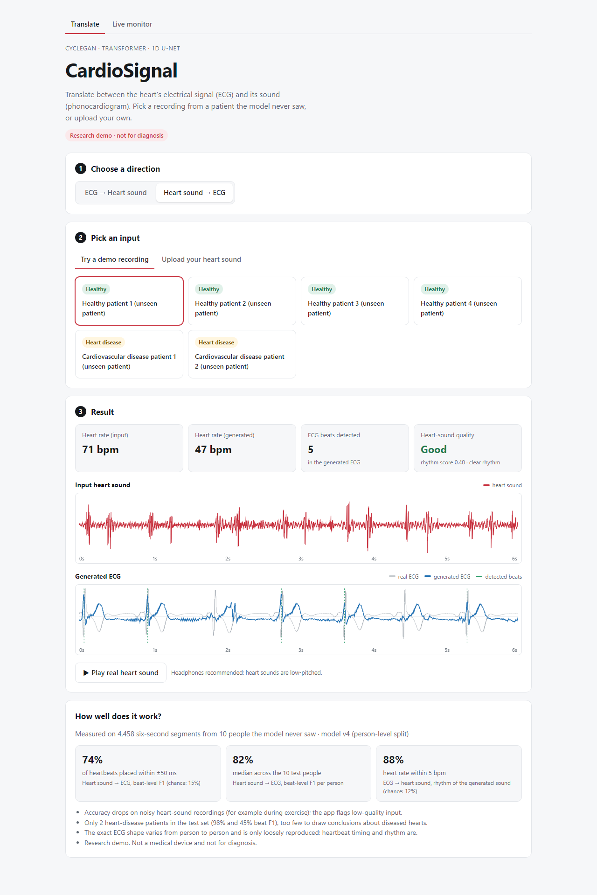
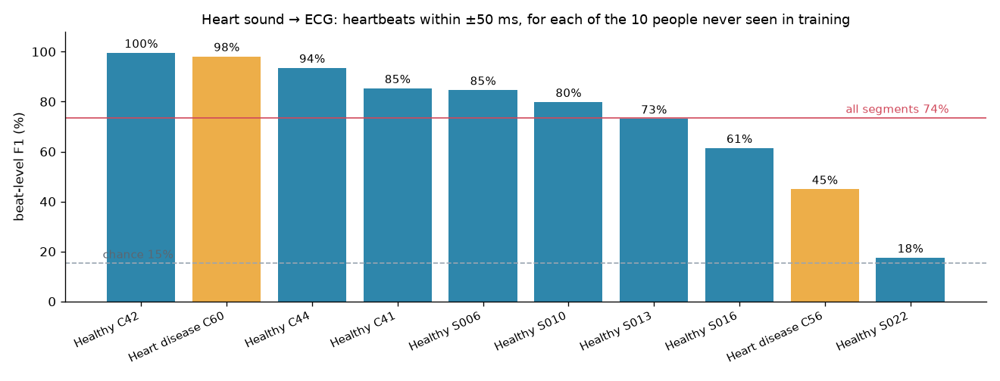
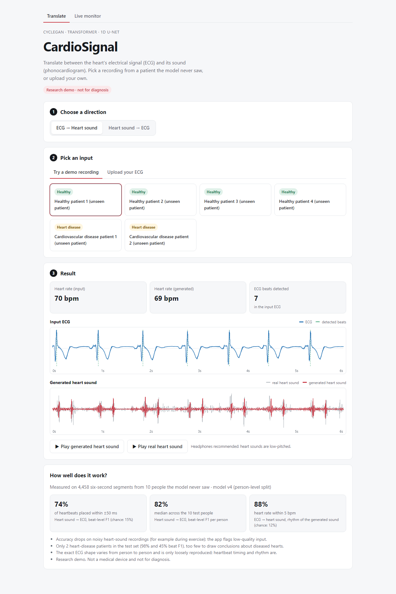
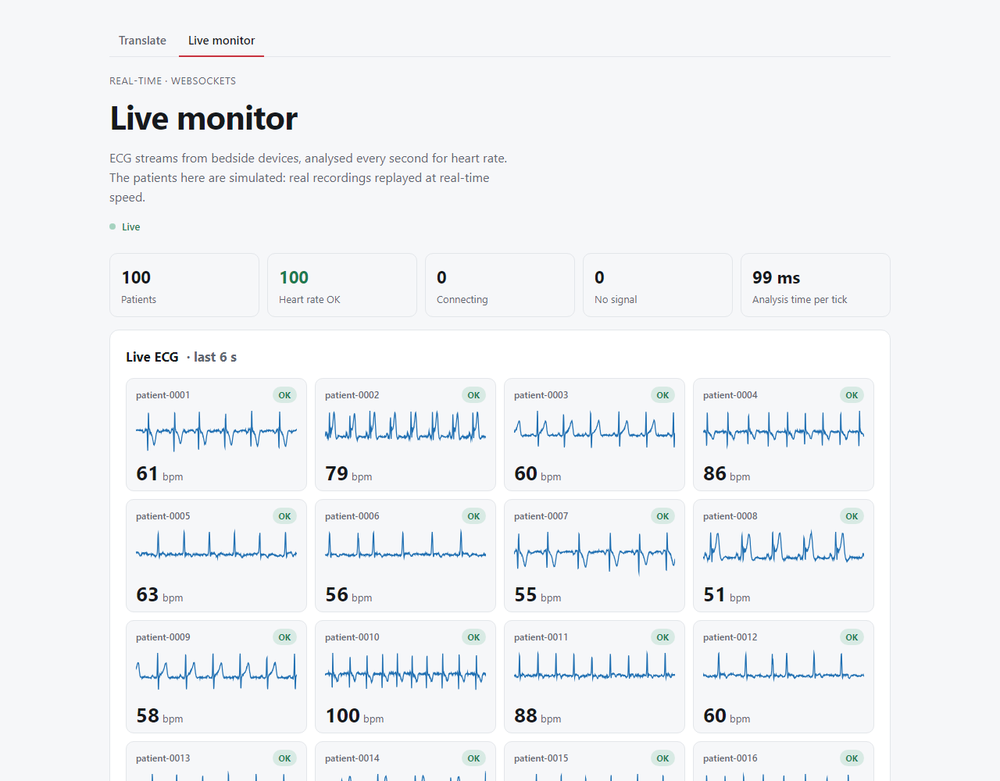

# CardioSignal

A web app that converts a heart's electrical signal (ECG) into its sound (phonocardiogram, PCG), and the other way
around. The model is a CycleGAN with a Transformer in the middle, and the app is FastAPI + React.

This started as a university lab project. I picked it up afterwards to fix the model, evaluate it properly and turn
it into something people can actually use.



*Heart sound → ECG for a patient the model never saw during training. Blue is the generated ECG, grey is the real one.*

## Results

I tested on 10 people that were never in the training data (4,458 six-second segments). The split is done by person,
so no one's recordings end up in both training and test.

| What I measured | Result | Random guess |
|---|---|---|
| Heart sound → ECG: heartbeats within ±50 ms of the real ones (F1) | 74% | 15% |
| Same thing, median over the 10 people | 82% | |
| Heart sound → ECG: median heart-rate error | 0.9 bpm | |
| ECG → heart sound: generated sound has the right heart rate (±5 bpm) | 88% | 12% |

There isn't one "accuracy" number here because the model generates whole signals instead of picking a class, so I
measured how many heartbeats it gets right and compared that to random guessing.

I also compared it with a simple method that doesn't use machine learning at all: find the loud peaks in the heart
sound and shift them a bit earlier. That gets 69%. The model gets 74%, and it was better for 7 of the 10 people (the
other 3 were about tied). So the model helps, but a lot of the timing information is already in the heart sound.



Results depend a lot on the recording. The two worst people had bad heart-sound audio: one was recorded while
cycling and the other barely had a clear heartbeat in the audio. That's why the app checks recording quality and
shows a warning when it's low.

## What went wrong and how I fixed it

When I first tested the original lab model, it wasn't translating anything. It just copied its input back out. These
are the main things I found and fixed along the way:

1. **Bugs in the training loop.** ECG and PCG were swapped, and the discriminators never learned from real signals.
2. **The identity loss.** It rewarded the model for copying its input, which is exactly what it learned to do.
   I removed it.
3. **Not using paired data.** CycleGAN is meant for unpaired data, but every ECG here was recorded at the same time
   as its heart sound. So I added losses that compare the output directly with the real signal.
4. **Upside-down ECGs.** 25–44% of the recordings were inverted (electrodes placed the other way round). The model
   can't tell that from a heart sound, so I flipped them all to the same orientation.
5. **My own evaluation was wrong at first.** My heartbeat detector was getting fooled by tall T-waves, so correct
   outputs were being marked wrong. I switched to a Pan–Tompkins style detector that looks at how steep the signal is.
6. **Data leakage.** This was the big one. I had split the healthy recordings by file instead of by person, and some
   people have lots of recordings. It turned out 15 of my 16 healthy test people were also in the training data, so
   my numbers were too optimistic. I matched every recording to its person (using PhysioNet's metadata for the
   EPHNOGRAM files), redid the split, retrained, and the results above are from that.

I also had one training run that looked much better on validation but was only tied on the test set. My validation
set was too small, so for the next run I made it about 7 times bigger.

I don't have a GPU, so I trained on Kaggle's free GPUs. The raw data was 31 GB, which I got down to under 1 GB
without dropping any recordings (lower sample rate of 2 kHz and 16-bit floats instead of 64-bit).

## What I learned

- Always split medical data by patient. A split by recording can look fine and still leak.
- Check the evaluation code as carefully as the model. Some of my "errors" were my scoring, not the model.
- Compare against a simple baseline, not just random chance. Otherwise you don't know if the ML part is worth it.
- Trust the test set over the validation set when they disagree, and make validation big enough to be useful.

## The app

- Upload an ECG or heart sound (CSV, TXT, NPY or WAV, any common sample rate, 3–60 s) or try one of the demo
  recordings from unseen patients.
- See the input and output as waveforms with the detected heartbeats marked, and the heart rate before and after.
- Play the real and generated heart sounds in the browser.
- The app shows a warning when the heart-sound recording is low quality.
- There's also a live monitor page that shows heart rates from many (simulated) patients streaming in over WebSockets.

Backend: FastAPI, PyTorch on CPU, input validation, rate limiting. Frontend: React, TypeScript, Vite.
Tests: pytest for the training code and backend, Vitest for the frontend, and Playwright for end-to-end tests.





## Running it

With Docker (from the `app/` folder):

```bash
cp .env.example .env        # set LIVE_INGEST_TOKEN to any random string
docker compose up --build
# then open http://localhost:8080
```

Without Docker:

```bash
# backend (Python 3.11+)
python -m venv .venv && .venv/Scripts/activate        # macOS/Linux: source .venv/bin/activate
pip install -r app/backend/requirements-dev.txt -e training
cd app/backend && LIVE_INGEST_TOKEN=<token> uvicorn cardiosignal_api.server:app --port 8000

# frontend (Node 22), in a second terminal
cd app/frontend && npm install && npm run dev          # http://localhost:5173

# optional: simulated patients for the live monitor, in a third terminal
cd app/backend && LIVE_INGEST_TOKEN=<token> python -m cardiosignal_api.live.simulator --patients 100
```

Tests:

```bash
cd training && pytest
cd app/backend && pytest
cd app/frontend && npm test && npx playwright test
```

## Project structure

```
training/        model, data preparation, training and evaluation scripts
  prepare_data.py   converts the raw lab recordings into train/val/test files
  splits.py         splits the data by person
  train.py          training script (runs on Kaggle)
  beat_accuracy.py  heartbeat-level evaluation
  baseline_beats.py the simple non-ML method I compare against
app/backend/     FastAPI server
app/frontend/    React website
docs/images/     screenshots and charts for this README
```

## Limitations

- Only 2 heart-disease patients are in the test set, which is too few to say how well it works on diseased hearts.
- It gets the timing of heartbeats right much better than the exact shape of the ECG.
- All the data comes from the same lab setup, so I don't know how it does on other devices.
- This is a student project, not a medical device. Please don't use it for diagnosis.

## Credits

The original CycleGAN-Transformer was a university lab project I worked on with Arshia and Adnan. The bug fixes,
new training setup, evaluation and web app in this repo are what I did after that.

Data: the lab's recordings and the [EPHNOGRAM](https://physionet.org/content/ephnogram/1.0.0/) dataset from PhysioNet.
